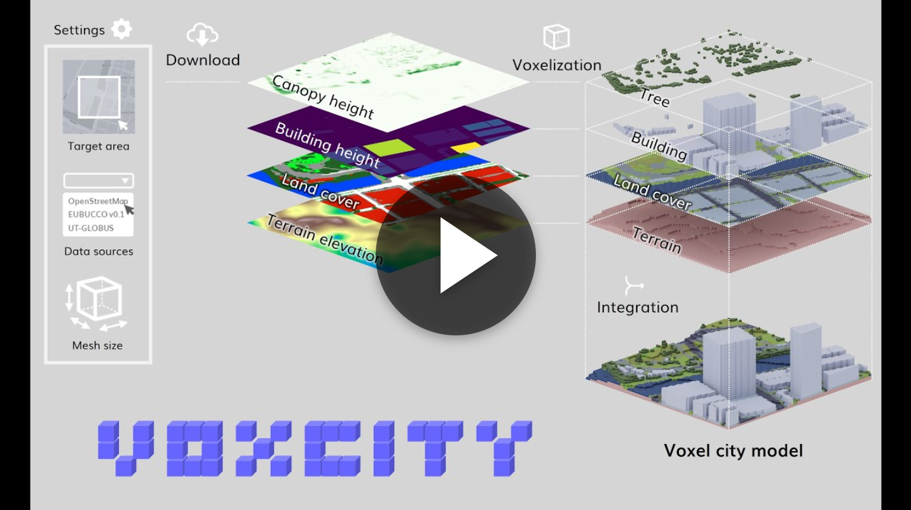

<p align="center">
  
</p>

<p align="center">
  <strong>Generate grid-based 3D city models anywhere on Earth from open geospatial data —<br>then simulate solar, view, and microclimate.</strong>
</p>

<p align="center">
  <a href="https://pypi.python.org/pypi/voxcity"></a>
  <a href="https://pypi.org/project/voxcity/"></a>
  <a href="https://pypi.org/project/voxcity/"></a>
  <a href="https://pepy.tech/project/voxcity"></a>
  <br>
  <a href="https://voxcity.readthedocs.io/en/latest/?badge=latest"></a>
  <a href="https://codecov.io/gh/kunifujiwara/VoxCity"></a>
  <a href="https://doi.org/10.1016/j.compenvurbsys.2025.102366"></a>
  <a href="https://github.com/kunifujiwara/VoxCity/stargazers"></a>
</p>

<p align="center">
  🚀 <a href="https://colab.research.google.com/github/kunifujiwara/VoxCity/blob/main/docs/examples/demo_quickstart.ipynb">Try in Colab</a> ·
  📖 <a href="https://voxcity.readthedocs.io/en/latest">Docs</a> ·
  🎬 <a href="https://youtu.be/qHusvKB07qk">Video</a> ·
  📄 <a href="https://doi.org/10.1016/j.compenvurbsys.2025.102366">Paper</a> ·
  💬 <a href="https://github.com/kunifujiwara/VoxCity/issues">Issues</a>
</p>

<p align="center">
  
</p>

---

## Table of Contents

- [Why VoxCity?](#why-voxcity)
- [Gallery](#gallery)
- [Quick Start](#quick-start)
- [Installation](#installation)
- [Tutorial](#tutorial)
- [Key Features](#key-features)
- [Usage Guide](#usage-guide)
- [Land Cover Classes](#voxcity-standard-land-cover-classes-used-in-voxel-grids)
- [Data Sources](#references-of-data-sources)
- [Community & Contributing](#community--contributing)
- [Citation](#citation)
- [Credits](#credit)

---

## Why VoxCity?

VoxCity turns open geospatial data into a single, simulation-ready 3D voxel model of any place on Earth — in a few lines of Python.

- 🌍 **Global by default** — automatically selects the best open data source for any location worldwide.
- 🔓 **No account needed** — buildings, canopy height, land cover, and terrain all have login-free default sources; Google Earth Engine is optional and adds more.
- 🧱 **One integrated voxel model** — buildings, trees, land cover, and terrain fused into a single semantic 3D grid; CityGML (e.g. Japan's PLATEAU) and Rhino OBJ buildings can be brought in too.
- ☀️ **Built-in simulation** — solar irradiance on the ground and on building surfaces, sky/green view index, landmark visibility, and street-network aggregation, with optional GPU acceleration.
- 🔄 **Export anywhere** — ENVI-met (INX/EDB), PALM (static driver), CityLES, OBJ (Blender/Rhino/Twinmotion), MagicaVoxel (VOX), GeoTIFF, NetCDF, and HDF5.
- 🧩 **Reproducible & open** — open data with documented provenance and a peer-reviewed method.

The **generator** module downloads building heights, tree canopy heights, land cover, and terrain elevation for a target area and voxelizes them into an integrated voxel city model. The **simulator** module runs environmental analyses such as solar radiation and view index. Try it in the [Google Colab Demo](https://colab.research.google.com/github/kunifujiwara/VoxCity/blob/main/docs/examples/demo_quickstart.ipynb) (no account, no coding) or locally, and see the [documentation](https://voxcity.readthedocs.io/en/latest) for the full API reference and tutorials.

## Gallery

<table align="center">
  <tr>
    <td align="center"><br><sub>☀️ Solar irradiance</sub></td>
    <td align="center"><br><sub>👁️ Sky / Green view index</sub></td>
    <td align="center"><br><sub>🌡️ ENVI-met microclimate</sub></td>
  </tr>
  <tr>
    <td align="center"><br><sub>🏙️ OBJ in Rhino / Blender</sub></td>
    <td align="center"><br><sub>🧊 MagicaVoxel</sub></td>
    <td align="center"><br><sub>🕸️ Network analysis</sub></td>
  </tr>
</table>

## Quick Start

```bash
pip install voxcity   # see Installation for a conda setup
```

```python
from voxcity.generator import get_voxcity

# A ~450 m box in Seattle (lon, lat corners)
rectangle_vertices = [
    (-122.3359, 47.5983), (-122.3359, 47.6028),
    (-122.3292, 47.6028), (-122.3292, 47.5983),
]

# Auto-selects the best data sources for the location; no account needed
voxcity = get_voxcity(rectangle_vertices, meshsize=5)
```

That's it — see the [Usage Guide](#usage-guide) to visualize, simulate, and export your model. With Earth Engine initialized, auto-selection also considers Earth Engine sources (higher-resolution DEMs, Open Buildings 2.5D, and more).

**Or start from a ready-made city.** Sixteen city centres, from Tokyo to São Paulo, are prebuilt on [Hugging Face](https://huggingface.co/datasets/kunifujiwara/voxcity-example-cities) and load in seconds:

```python
from voxcity.examples import list_example_cities, load_example_city

print([c["name"] for c in list_example_cities()])
voxcity = load_example_city("tokyo")   # 1 km × 1 km at 5 m, downloaded once and cached
```

## Installation

Make sure you have Python 3.10-3.13 installed. GDAL is the one dependency best installed via conda; everything else comes from pip.

### For Local Environment

```bash
conda create --name voxcity python=3.12
conda activate voxcity
conda install -c conda-forge gdal timezonefinder
pip install voxcity
```

### For Google Colab

```python
!pip install voxcity
```

### Optional: GPU acceleration

```bash
pip install "voxcity[gpu]"   # adds Taichi; enables voxcity.simulator_gpu
```

### Optional: Earth Engine

VoxCity works without any account. Google Earth Engine adds further sources (Open Buildings 2.5D, Dynamic World, ESRI land cover, and several high-resolution national DEMs). To use them, set up an Earth Engine enabled Cloud Project by following the [official guide](https://developers.google.com/earth-engine/cloud/earthengine_cloud_project_setup), then authenticate:

```bash
# Local environment
earthengine authenticate
```

```python
# Google Colab: click the displayed link, generate a token, then paste it
!earthengine authenticate --auth_mode=notebook
```

## Tutorial

### Google Colab Demos

Every notebook opens straight from this repository in Colab. None needs an account.

| Demo | Description | Link |
|------|-------------|------|
| **Quickstart** (no coding) | Build a 3D city, simulate sunlight and sky view, export | <a href="https://colab.research.google.com/github/kunifujiwara/VoxCity/blob/main/docs/examples/demo_quickstart.ipynb">Open in Colab</a> |
| **Complete demo** | Every main option: areas, data sources, visualization, simulations, exports | <a href="https://colab.research.google.com/github/kunifujiwara/VoxCity/blob/main/docs/examples/demo_basic.ipynb">Open in Colab</a> |
| **Data sources** | Which sources exist, which need an account, and what is picked automatically | <a href="https://colab.research.google.com/github/kunifujiwara/VoxCity/blob/main/docs/examples/demo_data_sources.ipynb">Open in Colab</a> |
| **Solar irradiance** | Street level and building surfaces, one moment or a whole year | <a href="https://colab.research.google.com/github/kunifujiwara/VoxCity/blob/main/docs/examples/demo_solar.ipynb">Open in Colab</a> |
| **View index** | Green view and sky view index | <a href="https://colab.research.google.com/github/kunifujiwara/VoxCity/blob/main/docs/examples/demo_view.ipynb">Open in Colab</a> |
| **Landmark visibility** | Where a chosen building can be seen from | <a href="https://colab.research.google.com/github/kunifujiwara/VoxCity/blob/main/docs/examples/demo_landmark.ipynb">Open in Colab</a> |
| **Shade the Walk** | A year of sunlight on a walking route, then place trees to shade it | <a href="https://colab.research.google.com/github/kunifujiwara/VoxCity/blob/main/docs/examples/demo_shade_the_walk.ipynb">Open in Colab</a> |
| **3D visualization** | Interactive views, rendered images, colour schemes, results on the model | <a href="https://colab.research.google.com/github/kunifujiwara/VoxCity/blob/main/docs/examples/demo_3d_visualization.ipynb">Open in Colab</a> |
| **Export** | Every format: OBJ, VOX, GeoTIFF, NetCDF, ENVI-met, PALM, CityLES, H5 | <a href="https://colab.research.google.com/github/kunifujiwara/VoxCity/blob/main/docs/examples/demo_export.ipynb">Open in Colab</a> |
| **ENVI-met export** | INX and plant database, with material and grid options | <a href="https://colab.research.google.com/github/kunifujiwara/VoxCity/blob/main/docs/examples/demo_envi-met.ipynb">Open in Colab</a> |

### YouTube Video

- **Walkthrough**: <a href="https://youtu.be/qHusvKB07qk">Watch on YouTube</a>

<p align="center">
  <a href="https://youtu.be/qHusvKB07qk" title="Click to watch the VoxCity tutorial on YouTube">
    
  </a>
</p>

<p align="center">
  <em>Tutorial video by <a href="https://ual.sg/author/xiucheng-liang/">Xiucheng Liang</a></em>
</p>


## Key Features

- **Integrated voxel model:** buildings, tree canopy, land cover, and terrain fused into one semantic 3D grid with a documented [coordinate system](#coordinate-system).

- **Data sources, chosen for you:** `get_voxcity` picks sources by location, or you choose them.
  - Buildings: OpenStreetMap, Overture, Microsoft Building Footprints, Global Building Atlas, EUBUCCO, Open Buildings 2.5D, England / Netherlands DSM − DTM, or your own file
  - Land cover: OpenStreetMap, ESA WorldCover, OpenEarthMap Japan, UrbanWatch, ESRI 10m, Dynamic World
  - Canopy height: Meta/WRI 1 m canopy height v2 (default) and v1, ETH Sentinel-2 10 m
  - Terrain: FABDEM, Copernicus DEM, USGS 3DEP (10 m and 1 m), GSI DEM Japan, DeltaDTM, and national 0.5–5 m DEMs for England, France, the Netherlands, and Australia
  - No account needed for OpenStreetMap, Overture, Microsoft, Global Building Atlas, EUBUCCO, ESA WorldCover, OpenEarthMap Japan, canopy v2, FABDEM, Copernicus, USGS 3DEP 10 m, and GSI DEM Japan. The rest come through Google Earth Engine.

  *Details for each source are in [References of Data Sources](#references-of-data-sources).*

- **More inputs:** CityGML LOD1/LOD2 (e.g. Japan's PLATEAU) via `get_voxcity_CityGML`, and buildings designed in Rhino via `add_buildings_from_obj`.

- **Area and resolution:** give corner coordinates, draw a box on a map (aligned, rotated, or fixed size), and set any mesh size.

- **Simulation:**
  - Solar irradiance on the ground and on building surfaces, instantaneous or cumulative, from EPW weather downloaded automatically
  - Sky view index and green view index
  - Landmark visibility
  - Street-network aggregation of any result
  - Optional GPU versions of the solar and visibility tools (`voxcity.simulator_gpu`)

- **Output formats:** ENVI-met (INX/EDB), PALM static driver, CityLES, OBJ, MagicaVoxel (VOX), GeoTIFF layers, NetCDF, and HDF5 for saving and reloading models (`save_voxcity` / `load_voxcity`).

## Usage Guide

> Define an area, generate the model, then simulate or export. The core path is shown open; advanced steps are collapsed.

### 1. (Optional) Authenticate Earth Engine

Skip this step unless you want Earth Engine sources. Everything else works without it.

```python
import ee
ee.Authenticate()
ee.Initialize(project='your-project-id')
```

### 2. Define Target Area

<details>
<summary>🗺️ Two ways to define your target area (coordinates, or draw on a map)</summary>

You can define your target area in two ways:

#### Option 1: Direct Coordinate Input
Define the target area by directly specifying the coordinates of the rectangle vertices.

```python
rectangle_vertices = [
    (-122.33587348582083, 47.59830044521263),  # Southwest corner (longitude, latitude)
    (-122.33587348582083, 47.60279755390168),  # Northwest corner (longitude, latitude) 
    (-122.32922451417917, 47.60279755390168),  # Northeast corner (longitude, latitude)
    (-122.32922451417917, 47.59830044521263)   # Southeast corner (longitude, latitude)
]
```

#### Option 2: Draw on a Map (for Jupyter Notebook)
One map with a side panel: type a city, then draw an aligned or rotated box, or click **Fixed** and click a centre point to place a box of the given width and height (metres).

```python
from voxcity.geoprocessor.draw import create_rectangle_map

m, rectangle_vertices = create_rectangle_map("tokyo", zoom=15, width=500, height=500)
m
```

`draw_rectangle_map_cityname` and `center_location_map_cityname` still work for drawing only a free box or only a fixed-size box.
<p align="center">
  
</p>

</details>

#### Coordinate system

VoxCity arrays follow one convention everywhere, and every saved file
declares it:

- **Array axes**: `grid[i, j]` / `voxels[i, j, k]` with **axis 0 = north**
  (row 0 is the **south** edge, i increases northward), **axis 1 = east**,
  **axis 2 = up**. Note this differs from the common `(x=east, y=north)`
  habit — component 0 of a direction vector is the **northward** one.
- **Azimuths** are compass degrees clockwise from north, *toward*
  directions. Meteorological *from*-directions must be converted first —
  e.g. for wind: `az_toward = az_from + 180`, then
  `d = voxcity.direction_to_axis_vector(az_toward)` gives
  `(d_north, d_east, d_up)`.
- **Rotated AOIs**: files store the `axes` / `rotation_angle` attribute
  pair. The axis tokens apply in the frame rotated clockwise by
  `rotation_angle` degrees; for axis-aligned AOIs (`rotation_angle = 0`)
  they are literally true.
- **Vertical datum**: `k` indexes cells above the domain base plane; a cell
  centre sits at height `(k + 0.5) * meshsize`. The DEM is filled in as
  solid voxels, so height-above-ground requires subtracting local terrain.
- **Self-describing files**: HDF5 outputs are `voxcity_results.v3` — they
  carry `axes = "north,east,up"`, `rotation_angle`, and the
  `rectangle_vertices` geometry. Assert the contract from any consumer with
  `voxcity.check_axes(path)`. Files from VoxCity 1.x must be converted once:
  `python -m voxcity.migrate old_results.h5`.
- **Named-dimension access**: prefer `city.to_xarray()` over raw-array
  indexing — dims are `("north", "east", "up")`, so
  `ds.dem.isel(north=0)` is unambiguously the south edge and silent
  transposes are impossible.

### 3. Set Parameters

Define mesh size (required) and optional data sources:

```python
meshsize = 5  # Grid cell size in meters (required)

# Optional: Specify output directory and other settings
kwargs = {
    "output_dir": "output",   # Directory to save output files
    "dem_interpolation": True # Enable DEM interpolation
}
```

### 4. Generate the Model

`get_voxcity` returns a `VoxCity` object holding the voxel grid, the 2D layers (buildings, canopy, land cover, DEM), and the building GeoDataFrame in `voxcity.extras['building_gdf']`.

#### Option 1: Automatic Mode (Recommended)
Data sources are automatically selected based on location:

```python
from voxcity.generator import get_voxcity

# Auto mode: all data sources selected automatically based on location
voxcity = get_voxcity(
    rectangle_vertices,
    meshsize,
    **kwargs
)
```

#### Option 2: Custom Mode
Specify data sources explicitly (all four below need no account):

```python
# Custom mode: specify all data sources
voxcity = get_voxcity(
    rectangle_vertices,
    meshsize,
    building_source='OpenStreetMap',
    building_complementary_source='Microsoft Building Footprints',
    land_cover_source='ESA WorldCover',
    canopy_height_source='High Resolution 1m Global Canopy Height Maps v2',
    dem_source='FABDEM',
    **kwargs
)
```

The source names accepted for each layer are listed in [References of Data Sources](#references-of-data-sources).

#### Option 3: Hybrid Mode
Specify some sources, auto-select others:

```python
# Hybrid mode: specify building source, auto-select others
voxcity = get_voxcity(
    rectangle_vertices,
    meshsize,
    building_source='Overture',  # Custom
    # land_cover_source, canopy_height_source, dem_source auto-selected
    **kwargs
)
```

#### More inputs

<details>
<summary>📥 Import Rhino / OBJ buildings into a model</summary>

#### Importing Rhino Models (OBJ):

You can import buildings authored in Rhino into a VoxCity model:

```python
from voxcity.importer import add_buildings_from_obj

voxcity = add_buildings_from_obj(
    voxcity, "design.obj",
    anchor_lonlat=(139.7536, 35.6841),  # world (lon, lat) of the model anchor
    anchor_elevation=12.0,              # world elevation (m) of the anchor
    rotation=0.0, units="m",
)
```

See [docs/guides/rhino_obj_import.md](docs/guides/rhino_obj_import.md) for the full Rhino export guide.

</details>

<details>
<summary>🏯 CityGML (e.g. Japan's PLATEAU) instead of downloaded buildings</summary>

#### Building a model from CityGML:

```python
from voxcity.generator import get_voxcity_CityGML

voxcity = get_voxcity_CityGML(
    rectangle_vertices,
    land_cover_source='OpenStreetMap',
    canopy_height_source='High Resolution 1m Global Canopy Height Maps v2',
    meshsize=meshsize,
    citygml_path="path/to/citygml_folder",   # or url_citygml="https://..." for a PLATEAU zip
)
```

See the [VoxCityGML](https://github.com/kunifujiwara/VoxCityGML) repository and its [paper](https://isprs-annals.copernicus.org/articles/XII-4-W1-2026/137/2026/) for LOD2 workflows.

</details>

### 5. Visualize

```python
from voxcity.visualizer import visualize_voxcity

visualize_voxcity(voxcity, mode="interactive")             # rotate and zoom in the notebook
images = visualize_voxcity(voxcity, mode="static", output_directory="output")   # PNG views
```

- **Open interactive demo**: <a href="https://voxcity.readthedocs.io/en/latest/_static/plotly/voxcity_demo.html">Launch the Plotly 3D viewer</a>

### 6. Simulate

Run environmental analyses directly on the generated voxel model. Each is collapsed below. With `pip install "voxcity[gpu]"`, the same functions are available on the GPU under `voxcity.simulator_gpu.solar` and `voxcity.simulator_gpu.visibility`.

<details>
<summary>☀️ Solar irradiance (instantaneous & cumulative)</summary>

#### Compute Solar Irradiance:

```python
from voxcity.simulator.solar import get_global_solar_irradiance_using_epw

solar_kwargs = {
    "download_nearest_epw": True,  # Whether to automatically download nearest EPW weather file based on location from Climate.OneBuilding.Org
    # "epw_file_path": "./output/new.york-downtown.manhattan.heli_ny_usa_1.epw",  # Path to EnergyPlus Weather (EPW) file containing climate data. Set if you already have an EPW file.
    "calc_time": "01-01 12:00:00",  # Time for instantaneous calculation in format "MM-DD HH:MM:SS"
    "view_point_height": 1.5,  # Height of view point in meters for calculating solar access. Default: 1.5 m
    "tree_k": 0.6,    # Static extinction coefficient - controls how much sunlight is blocked by trees (higher = more blocking)
    "tree_lad": 1.0,    # Leaf area density of trees - density of leaves/branches that affect shading (higher = denser foliage)
    "colormap": 'magma',       # Matplotlib colormap for visualization. Default: 'viridis'
    "obj_export": True,        # Whether to export results as 3D OBJ file
    "output_directory": 'output/test',  # Directory for saving output files
    "output_file_name": 'instantaneous_solar_irradiance',  # Base filename for outputs (without extension)
    "alpha": 1.0,             # Transparency of visualization (0.0-1.0)
    "vmin": 0,               # Minimum value for colormap scaling in visualization
    # "vmax": 900,             # Maximum value for colormap scaling in visualization
}

# Compute global solar irradiance map (direct + diffuse radiation)
solar_grid = get_global_solar_irradiance_using_epw(
    voxcity,                             # VoxCity object containing voxel data and metadata
    calc_type='instantaneous',           # Calculate instantaneous irradiance at specified time
    direct_normal_irradiance_scaling=1.0, # Scaling factor for direct solar radiation (1.0 = no scaling)
    diffuse_irradiance_scaling=1.0,      # Scaling factor for diffuse solar radiation (1.0 = no scaling)
    **solar_kwargs                       # Pass all the parameters defined above
)

# Adjust parameters for cumulative calculation
solar_kwargs["start_time"] = "01-01 01:00:00" # Start time for cumulative calculation
solar_kwargs["end_time"] = "01-31 23:00:00" # End time for cumulative calculation
solar_kwargs["output_file_name"] = 'cumulative_solar_irradiance'  # Base filename for outputs (without extension)

# Calculate cumulative solar irradiance over the specified time period
cum_solar_grid = get_global_solar_irradiance_using_epw(
    voxcity,                             # VoxCity object containing voxel data and metadata
    calc_type='cumulative',              # Calculate cumulative irradiance over time period instead of instantaneous
    direct_normal_irradiance_scaling=1.0, # Scaling factor for direct solar radiation (1.0 = no scaling)
    diffuse_irradiance_scaling=1.0,      # Scaling factor for diffuse solar radiation (1.0 = no scaling)
    **solar_kwargs                       # Pass all the parameters defined above
)
```

<p align="center">
  
</p>
<p align="center">
  <em>Example Results Saved as OBJ and Rendered in Rhino</em>
</p>

</details>

<details>
<summary>👁️ Green View Index (GVI) & Sky View Index (SVI)</summary>

#### Compute Green View Index (GVI) and Sky View Index (SVI):

```python
from voxcity.simulator.view import get_view_index

view_kwargs = {
    "view_point_height": 1.5,      # Height of observer viewpoint in meters
    "colormap": "viridis",         # Colormap for visualization
    "obj_export": True,            # Whether to export as OBJ file
    "output_directory": "output",  # Directory to save output files
    "output_file_name": "gvi"      # Base filename for outputs
}

# Compute Green View Index using mode='green'
gvi_grid = get_view_index(voxcity, mode='green', **view_kwargs)

# Adjust parameters for Sky View Index
view_kwargs["colormap"] = "BuPu_r"
view_kwargs["output_file_name"] = "svi"
view_kwargs["elevation_min_degrees"] = 0 # Start ray-tracing from the horizon

# Compute Sky View Index using mode='sky'
svi_grid = get_view_index(voxcity, mode='sky', **view_kwargs)
```
<p align="center">
  
</p>
<p align="center">
  <em>Example Results Saved as OBJ and Rendered in Rhino</em>
</p>

</details>

<details>
<summary>🗼 Landmark visibility map</summary>

#### Landmark Visibility Map:

```python
from voxcity.simulator.view import get_landmark_visibility_map

# Dictionary of parameters for landmark visibility analysis
landmark_kwargs = {
    "view_point_height": 1.5,                 # Height of observer viewpoint in meters
    "colormap": "cool",                       # Colormap for visualization
    "obj_export": True,                       # Whether to export as OBJ file
    "output_directory": "output",             # Directory to save output files
    "output_file_name": "landmark_visibility" # Base filename for outputs
}
landmark_vis_map, _ = get_landmark_visibility_map(voxcity, voxcity.extras.get('building_gdf'), **landmark_kwargs)
```
<p align="center">
  
</p>
<p align="center">
  <em>Example Result Saved as OBJ and Rendered in Rhino</em>
</p>

</details>

<details>
<summary>🕸️ Network analysis (map values onto a street network)</summary>

#### Network Analysis:

```python
from voxcity.geoprocessor.network import get_network_values

network_kwargs = {
    "network_type": "walk",        # Type of network to download from OSM (walk, drive, all, etc.)
    "colormap": "magma",          # Matplotlib colormap for visualization
    "vis_graph": True,            # Whether to display the network visualization
    "vmin": 0.0,                  # Minimum value for color scaling
    "vmax": 600000,               # Maximum value for color scaling
    "edge_width": 2,              # Width of network edges in visualization
    "alpha": 0.8,                 # Transparency of network edges
    "zoom": 16                    # Zoom level for basemap
}

G, edge_gdf = get_network_values(
    cum_solar_grid,               # Grid of cumulative solar irradiance values
    rectangle_vertices,           # Coordinates defining simulation domain boundary
    meshsize,                     # Size of each grid cell in meters
    value_name='Cumulative Global Solar Irradiance (W/m²·hour)',  # Label for values in visualization
    **network_kwargs              # Additional visualization and network parameters
)
```

<p align="center">
  
</p>
<p align="center">
  <em>Cumulative Global Solar Irradiance (kW/m²·hour) on Road Network</em>
</p>

</details>

### 7. Export and Save

Export your model to the format your downstream tool expects — each target is collapsed below.

<details>
<summary>🌡️ ENVI-met (INX/EDB) — microclimate simulation</summary>

#### ENVI-MET INX/EDB Files:
[ENVI-MET](https://www.envi-met.com/) is an advanced microclimate simulation software specialized in modeling urban environments. It simulates the interactions between buildings, vegetation, and various climate parameters like temperature, wind flow, humidity, and radiation. The software is used widely in urban planning, architecture, and environmental studies (Commercial, offers educational licenses).

```python
from voxcity.exporter.envimet import export_inx, generate_edb_file

envimet_kwargs = {
    "output_directory": "output",            # Directory where output files will be saved
    "file_basename": "voxcity",              # Base name (without extension) for INX
    "author_name": "your name",              # Name of the model author
    "model_description": "generated with voxcity",  # Description for the model
    "domain_building_max_height_ratio": 2,   # Max ratio between domain height and tallest building
    "useTelescoping_grid": True,             # Enable telescoping grid
    "verticalStretch": 20,                   # Vertical grid stretching factor (%)
    "min_grids_Z": 20,                       # Minimum number of vertical grid cells
    "lad": 1.0                               # Leaf Area Density (m2/m3) for EDB generation
}

# Optional: specify land cover source used for export (otherwise taken from voxcity.extras when available)
land_cover_source = 'OpenStreetMap'

# Export INX by passing the VoxCity object directly
export_inx(
    voxcity,
    output_directory=envimet_kwargs["output_directory"],
    file_basename=envimet_kwargs["file_basename"],
    land_cover_source=land_cover_source,
    author_name=envimet_kwargs["author_name"],
    model_description=envimet_kwargs["model_description"],
    domain_building_max_height_ratio=envimet_kwargs["domain_building_max_height_ratio"],
    useTelescoping_grid=envimet_kwargs["useTelescoping_grid"],
    verticalStretch=envimet_kwargs["verticalStretch"],
    min_grids_Z=envimet_kwargs["min_grids_Z"],
)

# Generate plant database (EDB) for vegetation
generate_edb_file(lad=envimet_kwargs["lad"])
```
<p align="center">
  
</p>
<p align="center">
  <em>Example Output Exported in INX and Inported in ENVI-met</em>
</p>

</details>

<details>
<summary>💨 PALM (NetCDF static driver) — LES urban-climate simulation</summary>

#### PALM Static Driver Files:

```python
from voxcity.exporter.palm import export_palm

# Pass the VoxCity object directly; writes <domain_name>_static to output_directory
export_palm(
    voxcity,
    output_directory="output/palm",
    domain_name="voxcity",
    lad=1.0,              # Leaf Area Density (m2/m3) inside tree crowns
    buildings_3d="auto",  # write the domain-wide LOD2 building mask only when some building needs it (LOD1 alone can't express it)
)
```

[PALM](https://palm.muk.uni-hannover.de/) is an open-source large-eddy simulation (LES) model widely used for atmospheric boundary-layer and urban-climate research. `export_palm` writes a single PIDS-conformant NetCDF `<domain_name>_static` file — terrain, buildings (2D + optional 3D), surface classification, and leaf area density — validated against PALM's documented consistency rules before it's written.

**Namelist note:** building footprints are deliberately left without a ground surface class (matching PALM's own reference drivers), so a domain with buildings needs the urban surface model enabled in your `_p3d` (`&urban_surface_parameters`, alongside `&land_surface_parameters` and a radiation scheme). Running with only the land surface model makes PALM reject the driver with `DRV0021` at those footprint cells. Dynamics-only runs (no surface-energy namelists at all) accept the driver as plain topography.

</details>

<details>
<summary>🏙️ OBJ — Blender / Rhino / Twinmotion</summary>

#### OBJ Files:

```python
from voxcity.exporter.obj import export_obj

output_directory = "output"  # Directory where output files will be saved
output_file_name = "voxcity" # Base name for the output OBJ file
# Pass the VoxCity object directly (voxel size inferred)
export_obj(voxcity, output_directory, output_file_name)
```
The generated OBJ files can be opened and rendered in the following 3D visualization software:

- [Twinmotion](https://www.twinmotion.com/): Real-time visualization tool (Free for personal use)
- [Blender](https://www.blender.org/): Professional-grade 3D creation suite (Free)
- [Rhino](https://www.rhino3d.com/): Professional 3D modeling software (Commercial, offers educational licenses)

<p align="center">
  
</p>
<p align="center">
  <em>Example Output Exported in OBJ and Rendered in Rhino</em>
</p>

</details>

<details>
<summary>🧊 MagicaVoxel (VOX) — voxel art editor</summary>

#### MagicaVoxel VOX Files:

[MagicaVoxel](https://ephtracy.github.io/) is a lightweight and user-friendly voxel art editor. It allows users to create, edit, and render voxel-based 3D models with an intuitive interface, making it perfect for modifying and visualizing voxelized city models. The software is free and available for Windows and Mac.

```python
from voxcity.exporter.magicavoxel import export_magicavoxel_vox

output_path = "output"
base_filename = "voxcity"
# Pass the VoxCity object directly
export_magicavoxel_vox(voxcity, output_path, base_filename=base_filename)
```
<p align="center">
  
</p>
<p align="center">
  <em>Example Output Exported in VOX and Rendered in MagicaVoxel</em>
</p>

</details>

<details>
<summary>🗺️ GeoTIFF, NetCDF, and CityLES</summary>

```python
from voxcity.exporter.geotiff import export_geotiffs
from voxcity.exporter.netcdf import save_voxel_netcdf
from voxcity.exporter.cityles import export_cityles

export_geotiffs(voxcity, "output/geotiff")     # land cover, building height, DEM, canopy height
save_voxel_netcdf(voxcity.voxels.classes, "output/voxcity.nc",
                  voxel_size_m=meshsize, rectangle_vertices=rectangle_vertices)
export_cityles(voxcity, output_directory="output/cityles")
```

</details>

<details>
<summary>💾 Save and reload a model (HDF5)</summary>

```python
from voxcity.generator import save_voxcity, load_voxcity

save_voxcity("output/voxcity.h5", voxcity)
voxcity = load_voxcity("output/voxcity.h5")
```

`get_voxcity` also saves `output/voxcity.h5` automatically.

</details>

## VoxCity Standard Land Cover Classes (used in voxel grids)

| Index | Class | Index | Class |
|:-----:|-------|:-----:|-------|
| 1 | Bareland | 8 | Mangrove |
| 2 | Rangeland | 9 | Water |
| 3 | Shrub | 10 | Snow and ice |
| 4 | Agriculture land | 11 | Developed space |
| 5 | Tree | 12 | Road |
| 6 | Moss and lichen | 13 | Building |
| 7 | Wet land | 14 | No Data |

## References of Data Sources

VoxCity integrates many open datasets. The **Name** column is the string to pass to `get_voxcity`; **Account** says whether the source needs Google Earth Engine. Expand for full provenance (coverage, resolution, and acquisition).

<details>
<summary>📚 Full data source tables (buildings, canopy height, land cover, terrain)</summary>

### Building

| Dataset | Name | Coverage | Account | Source / acquisition |
|---------|------|----------|---------|----------------------|
| [OpenStreetMap](https://www.openstreetmap.org) | `OpenStreetMap` | Worldwide (24% completeness in city centers) | None | Volunteered / updated continuously |
| [Overture Maps](https://overturemaps.org/) | `Overture` | Worldwide | None | OpenStreetMap, Esri Community Maps Program, Google Open Buildings, etc. / updated continuously |
| [Microsoft Building Footprints](https://github.com/microsoft/GlobalMLBuildingFootprints) | `Microsoft Building Footprints` | North America, Europe, Australia | None | Prediction from satellite or aerial imagery / 2018-2019 for majority of the input imagery |
| [Global Building Atlas](https://gee-community-catalog.org/projects/gba/) | `Global Building Atlas` | Worldwide | None | LOD1 building polygons with heights, read from data.source.coop |
| [EUBUCCO v0.1](https://eubucco.com/) | `EUBUCCO v0.1` | 27 EU countries and Switzerland (378 regions and 40,829 cities) | None | OpenStreetMap, government datasets / 2003-2021 (majority is after 2019) |
| [Open Buildings 2.5D Temporal Dataset](https://sites.research.google/gr/open-buildings/temporal/) | `Open Building 2.5D Temporal` | Africa, Latin America, and South and Southeast Asia | Earth Engine | Prediction from satellite imagery / 2016-2023 |
| [England 1m DSM − DTM](https://developers.google.com/earth-engine/datasets/catalog/UK_EA_ENGLAND_1M_TERRAIN_2022) | `England 1m DSM - DTM` | England | Earth Engine | Building heights from aerial LiDAR surface minus terrain |
| [Netherlands AHN4 DSM − DTM](https://developers.google.com/earth-engine/datasets/catalog/AHN_AHN4) | `Netherlands 0.5m DSM - DTM` | Netherlands | Earth Engine | Building heights from aerial LiDAR surface minus terrain |

Your own buildings: `Local file` (a GeoPackage given as `building_path`), a GeoDataFrame via `building_gdf`, CityGML via `get_voxcity_CityGML`, or Rhino OBJ via `add_buildings_from_obj`.

### Tree Canopy Height

| Dataset | Name | Coverage | Resolution | Account | Source / acquisition |
|---------|------|----------|------------|---------|----------------------|
| [High Resolution 1m Global Canopy Height Maps v2](https://registry.opendata.aws/dataforgood-fb-forestsv2/) | `High Resolution 1m Global Canopy Height Maps v2` (default) | Worldwide (land) | ~1.2 m | None | Meta/WRI CHMv2, read from AWS Open Data over anonymous HTTPS |
| [High Resolution 1m Global Canopy Height Maps](https://sustainability.atmeta.com/blog/2024/04/22/using-artificial-intelligence-to-map-the-earths-forests/) | `High Resolution 1m Global Canopy Height Maps` | Worldwide | 1 m | Earth Engine | Prediction from satellite imagery / 2009 and 2020 (80% are 2018-2020) |
| [ETH Global Sentinel-2 10m Canopy Height (2020)](https://langnico.github.io/globalcanopyheight/) | `ETH Global Sentinel-2 10m Canopy Height (2020)` | Worldwide | 10 m | Earth Engine | Prediction from satellite imagery / 2020 |
| OpenStreetMap trees | `OpenStreetMap` | Worldwide | Point / polygon | None | Mapped trees with default crown sizes |
| Land-cover based | `Static` | Worldwide | Grid | None | Fixed height on tree land-cover cells; the fallback when no canopy data is available |

### Land Cover

| Dataset | Name | Coverage | Resolution | Account | Source / acquisition |
|---------|------|----------|------------|---------|----------------------|
| [OpenStreetMap](https://www.openstreetmap.org) | `OpenStreetMap` | Worldwide | Vector | None | Volunteered / updated continuously |
| [ESA World Cover 10m 2021 V200](https://zenodo.org/records/7254221) | `ESA WorldCover` | Worldwide | 10 m | None | Prediction from satellite imagery / 2021 · read from AWS Open Data |
| [OpenEarthMap Japan](https://www.open-earth-map.org/demo/Japan/leaflet.html) | `OpenEarthMapJapan` | Japan | ~1 m | None | Prediction from aerial imagery / 1974-2022 (mostly after 2018 in major cities) |
| [UrbanWatch](https://urbanwatch.charlotte.edu/) | `Urbanwatch` | 22 major cities in the US | 1 m | Earth Engine | Prediction from aerial imagery / 2014–2017 |
| [ESRI 10m Annual Land Cover (2017-2023)](https://www.arcgis.com/home/item.html?id=cfcb7609de5f478eb7666240902d4d3d) | `ESRI 10m Annual Land Cover` | Worldwide | 10 m | Earth Engine | Prediction from satellite imagery / 2017-2023 |
| [Dynamic World V1](https://dynamicworld.app) | `Dynamic World V1` | Worldwide | 10 m | Earth Engine | Prediction from satellite imagery / updated continuously |

### Terrain Elevation

| Dataset | Name | Coverage | Resolution | Account | Source / acquisition |
|---------|------|----------|------------|---------|----------------------|
| [FABDEM](https://doi.org/10.5523/bris.s5hqmjcdj8yo2ibzi9b4ew3sn) | `FABDEM` | Worldwide | 30 m | None | Copernicus DEM corrected for canopy and buildings / 2011-2015 · CC BY-NC-SA 4.0 |
| [Copernicus DEM GLO-30](https://registry.opendata.aws/copernicus-dem/) | `COPERNICUS` | Worldwide | 30 m | None | Surface model (includes buildings and trees) / 2011-2015 · read from AWS Open Data |
| [USGS 3DEP 1/3 arc-second](https://www.usgs.gov/3d-elevation-program/about-3dep-products-services) | `USGS 3DEP 10m` | United States | ~10 m | None | Bare-earth DEM from lidar and other sources · read from AWS Open Data |
| [GSI DEM](https://maps.gsi.go.jp/development/ichiran.html) | `GSI DEM Japan` | Japan | 5 m / 10 m | None | Geospatial Information Authority of Japan bare-earth DEM |
| [USGS 3DEP 1m DEM](https://www.usgs.gov/3d-elevation-program) | `USGS 3DEP 1m` | United States | 1 m | Earth Engine | Aerial LiDAR / 2004-2024 (mostly after 2015) |
| [England 1m Composite DTM](https://environment.data.gov.uk/dataset/13787b9a-26a4-4775-8523-806d13af58fc) | `England 1m DTM` | England | 1 m | Earth Engine | Aerial LiDAR / 2000-2022 |
| [RGE Alti](https://geoservices.ign.fr/rgealti) | `DEM France 1m` / `DEM France 5m` | France | 1 m / 5 m | Earth Engine | Aerial LiDAR |
| [AHN4](https://www.ahn.nl/) | `Netherlands 0.5m DTM` | Netherlands | 0.5 m | Earth Engine | Aerial LiDAR |
| [Australian 5M DEM](https://ecat.ga.gov.au/geonetwork/srv/eng/catalog.search#/metadata/89644) | `AUSTRALIA 5M DEM` | Australia | 5 m | Earth Engine | Aerial LiDAR / 2001-2015 |
| [DeltaDTM](https://gee-community-catalog.org/projects/delta_dtm/) | `DeltaDTM` | Coastal areas below 10 m + mean sea level | 30 m | Earth Engine | Copernicus DEM, spaceborne LiDAR / 2011-2015 |
| [NASADEM](https://www.earthdata.nasa.gov/esds/competitive-programs/measures/nasadem) | `NASA` | Worldwide (60°N–56°S) | 30 m | Earth Engine | SRTM reprocessed / 2000 |
| Flat terrain | `Flat` | Anywhere | — | None | Zero elevation, for idealised studies |

</details>

## Community & Contributing

VoxCity is open source and community-driven — contributions of all kinds are welcome.

- 🐛 **Report bugs or request features** via the [issue tracker](https://github.com/kunifujiwara/VoxCity/issues).
- 💬 **Ask questions and share your work** in [Discussions](https://github.com/kunifujiwara/VoxCity/discussions).
- 🤝 **Contribute code** — see [CONTRIBUTING.rst](CONTRIBUTING.rst). To get started:

  ```bash
  git clone https://github.com/kunifujiwara/VoxCity.git
  cd VoxCity
  pip install -r requirements_dev.txt
  pytest
  ```

Please also review our [Code of Conduct](CODE_OF_CONDUCT.rst).

## Citation

Please cite the [paper](https://doi.org/10.1016/j.compenvurbsys.2025.102366) if you use `voxcity` in a scientific publication:

Fujiwara K, Tsurumi R, Kiyono T, Fan Z, Liang X, Lei B, Yap W, Ito K, Biljecki F., 2026. VoxCity: A Seamless Framework for Open Geospatial Data Integration, Grid-Based Semantic 3D City Model Generation, and Urban Environment Simulation. Computers, Environment and Urban Systems, 123, p.102366. https://doi.org/10.1016/j.compenvurbsys.2025.102366

```bibtex
@article{fujiwara2025voxcity,
  title={VoxCity: A Seamless Framework for Open Geospatial Data Integration, Grid-Based Semantic 3D City Model Generation, and Urban Environment Simulation},
  author={Fujiwara, Kunihiko and Tsurumi, Ryuta and Kiyono, Tomoki and Fan, Zicheng and Liang, Xiucheng and Lei, Binyu and Yap, Winston and Ito, Koichi and Biljecki, Filip},
  journal={Computers, Environment and Urban Systems},
  volume = {123},
  pages = {102366},
  year = {2026},
  doi = {10.1016/j.compenvurbsys.2025.102366}
}

```

## Credit

 - Tutorial video by <a href="https://ual.sg/author/xiucheng-liang/">Xiucheng Liang</a>

This package was created with [Cookiecutter](https://github.com/audreyr/cookiecutter) and the [`audreyr/cookiecutter-pypackage`](https://github.com/audreyr/cookiecutter-pypackage) project template.

--------------------------------------------------------------------------------
<br>
<br>
<p align="center">
  <a href="https://ual.sg/">
    
  </a>
</p>

